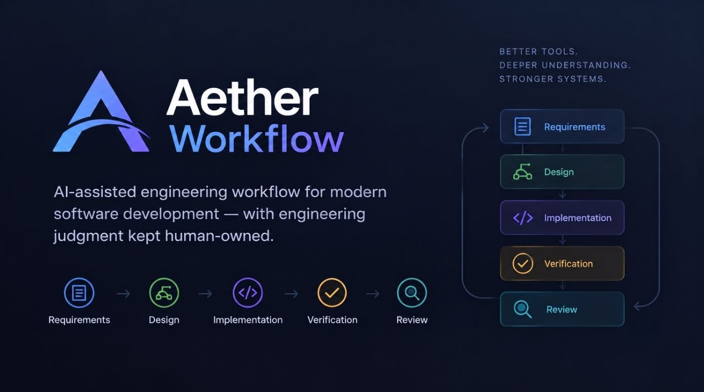

# aether-workflow



A Claude Code plugin, `aether-wfl`, for planning a change, implementing it, and reviewing it before merge. It also has an installer, `install.sh`, for the pieces a plugin can't carry: a shared-context tool, global git hooks and a few rules for your `CLAUDE.md`.

You decide what is built and what is merged. The plugin plans, checks and reports.

For the day-to-day flow, read [WORKFLOW.md](WORKFLOW.md).

## What's in it

Eight skills. Each is run as `/aether-wfl:<name>`.

| Skill | What it does |
|---|---|
| `plan-change` | Plans a change before any code: definition of done, reuse, security findings, tests, slices. Stops for your approval, then can implement it in waves. |
| `preflight` | Reviews a change before merge for what breaks, what drifts from the plan and what fits poorly. Reports only. |
| `codemap` | Builds a compact map of the codebase at `.plans/CODEMAP.md` so agents find things without exploring. |
| `pull` | Previews merging one branch into another without touching the target. Merges locally only if you say yes. |
| `pr` | Opens a PR (`gh`) or MR (`glab`) for a feature branch after the same merge preview. |
| `security-audit` | Security review of a codebase. Vendored from Cloudflare's security-audit-skill. |
| `dead-code` | Finds unused code with evidence for each item. Reports only; deletes nothing. |
| `diagnosing-bugs` | A diagnosis loop for hard bugs. Vendored from Matt Pocock's skills. |

Four hooks, active while the plugin is enabled:

- `codemap-stale.sh` (session start): prints one line if the codemap is behind recent commits.
- `model-guard.sh` (before an Agent or Task call): blocks subagents on Haiku or Fable.
- `test-guard.sh` (before an edit or a Bash command): asks you before an agent weakens a test to make it pass.
- `no-claude-coauthor.sh` (before a Bash command): blocks commits, merges, PRs and MRs that add Claude as co-author.

Two helper commands in `plugin/bin/`: `wfl-merge-check` (used by `pull` and `pr`) and `codemap-sync` (refreshes the codemap in the background after a merge into a main checkout).

Pieces that need `install.sh`:

- `bin/ctx`: a small Python tool that shares untracked project files (`.decisions`, `docs` and similar) between all worktrees of a repo. The files live in `~/Context/<repo>/`.
- `git/hooks/`: a global git hook dispatcher. It rejects a Claude co-author trailer and runs `codemap-sync` after a merge. It then calls the repo's own hook of the same name, so a global hooks path doesn't disable them.
- `rules/AETHER.md`: the workflow rules (models, change workflow, git, tests), imported into your `~/.claude/CLAUDE.md`.

## Requirements

- Claude Code
- git
- jq
- python3, for `ctx`
- `gh` or `glab`, for `/aether-wfl:pr`

## Install

```sh
git clone https://github.com/rpkchtrj/aether-workflow ~/aether-workflow
~/aether-workflow/install.sh
```

`install.sh` is safe to run again. It backs up a file before changing it and prints one line per change. It does this:

- Links `~/.local/bin/ctx` to `bin/ctx` in the clone.
- Sets the global `core.hooksPath` to `git/hooks` in the clone, only if it is unset. If it is set to something else, it is left alone and the installer says so.
- Edits `~/.claude/settings.json`: sets `attribution.commit` and `attribution.pr` to empty (no Claude attribution), adds `~/Context` to `permissions.additionalDirectories`, and adds a `ctx sync` hook to SessionStart and Stop.
- Appends one line, `@<clone>/rules/AETHER.md`, to `~/.claude/CLAUDE.md`. It never replaces the file, and does nothing if the line is there.
- Registers the marketplace `aether` and installs the plugin `aether-wfl@aether`, if the `claude` command is found.

The settings changes need `jq`. Without it, the installer says so and skips them.

### Plugin only

```sh
claude plugin marketplace add rpkchtrj/aether-workflow
claude plugin install aether-wfl@aether
```

You get the skills and hooks. You do not get `ctx`, the global git hooks or the rules in `CLAUDE.md`. Without the git hooks there is no automatic codemap refresh after a merge, and without the rules the model and workflow guidance is not loaded.

### Keep the clone where it is

The global hooks path and the `ctx` link point into the clone. If you move or delete `~/aether-workflow`, git hooks stop working and `ctx` breaks. The `CLAUDE.md` import breaks too. Move it, then run `install.sh` again from the new place, and remove the old settings by hand.

### Update

Full install:

```sh
git -C ~/aether-workflow pull
claude plugin marketplace update aether
claude plugin update aether-wfl@aether
```

Plugin only: the last two commands. Then restart Claude Code. To stay on a release, check out its tag instead of pulling (`git -C ~/aether-workflow checkout v3.1.1`); [CHANGELOG.md](CHANGELOG.md) lists what each one changed.

## Optional companion

Not installed by this repo; it has its own installer.

- `/understand` from the understand-anything plugin: an interactive tour of a codebase. **aether does not install it and does not depend on it.** If its knowledge graph exists in a repo, `/aether-wfl:codemap` uses it as a starting inventory; otherwise codemap maps the repo on its own. If you use it, run it in the main checkout and leave its auto-update off.

## Upgrading from v2

v2 was an npm package, `aether-workflow`, with its own installer and host adapters. It is deprecated and replaced by this plugin. The v2 code is kept under the git tag `v2-final`.

v3 does not read or migrate v2 state. Remove the old install by hand, then follow Install above.

## License

MIT. See [LICENSE](LICENSE).

Two skills are vendored from other projects, also under the MIT license. Each folder keeps its own `LICENSE` and an `UPSTREAM` file that records the source and version:

- `plugin/skills/security-audit/`: from Cloudflare's security-audit-skill.
- `plugin/skills/diagnosing-bugs/`: from Matt Pocock's skills, version 1.3.1.
